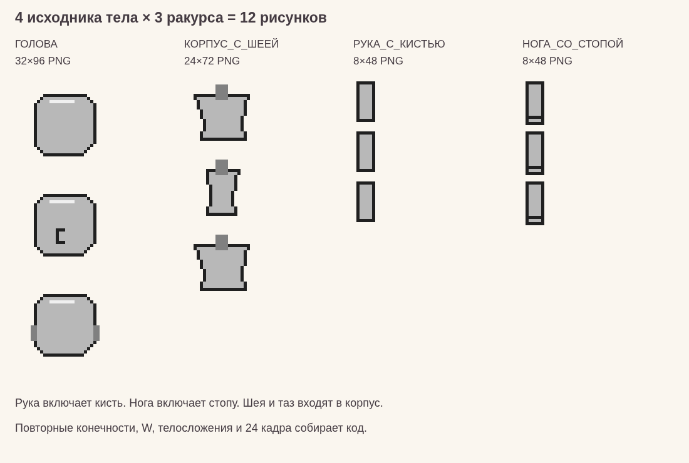

# Персонаж — комплект для художника

**[Скачать комплект для художника](ДЛЯ_ХУДОЖНИКА.zip)** — ТЗ, пустые холсты, подложки и схемы; без A24 и архивных материалов.

Начать с **[ТЗ*ДЛЯ*ХУДОЖНИКА.md](ТЗ_ДЛЯ_ХУДОЖНИКА.md)**. В нём весь заказ: детали тела, ракурсы, точные размеры, количество вариантов редактора, цвета и приёмка. Не нужно читать инженерные документы, чтобы начать рисовать.

- `ПУСТОЙ_…_V3.png` — прозрачные холсты для рисования.
- `ПОДЛОЖКА_…_V3.png` — посадочные силуэты, скрыть перед экспортом.
- `СХЕМА_….png` — увеличенные схемы с точкой крепления.
- `ПРОПОРЦИИ_ТЕЛА.png` — сравнение телосложений; рисовать нужно только среднее.

**База: голова + корпус с шеей/тазом + цельная рука с кистью + цельная нога со стопой. Три статических вида N/E/S.** W, вторая конечность и движения создаются программно. Не рисовать A24 и отдельные комплекты цветов/телосложений.

Файлы `*_A24.png`, `РИГ.json`, `ШАБЛОНЫ.json`, `КОМПЛЕКТ_ТЕЛА.json`, `ЗАМЕРЫ.json` и документы 01–07 — автоматические просмотры и сведения для разработчика. Художник не воспроизводит их вручную. `ПРИЧЕСКИ_ИСХОДНИК.png` — прежний тестовый исходник, а не эталон посадки новых волос: новые детали используют общую опору (16,16).

`АРХИВ_ПРЕЖНИХ_ШАБЛОНОВ` сохранён только как история. Старые V4/отдельные шея, кисти и таз из архива **не входят в текущий заказ**.
