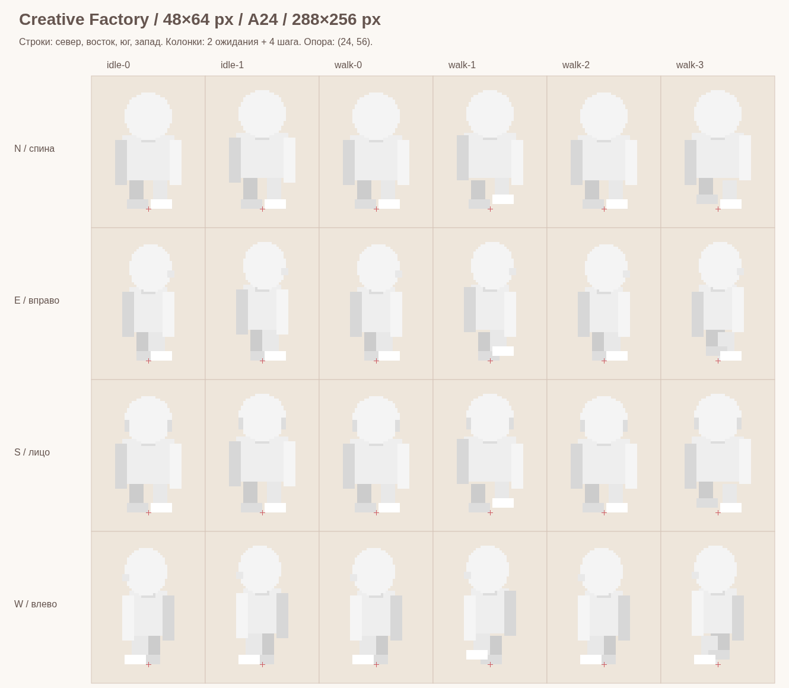

# Архив предыдущего полного A24-подхода

Это история, а не действующее ТЗ. Двенадцать тел и матрица 865 файлов заменены универсальным взрослым ригом. Сохранены исходные эталоны, ORA, палитры и схемы. Активный комплект: [../README.md](../README.md).

# Creative Factory — комплект художнику

Актуальный комплект от 27 октября 2026 года для **нынешнего конструктора**: тело, голова, одежда, детали. Все новые ТЗ и эталонные картинки находятся здесь, в одной плоской папке. Это оригинальные технические заготовки Creative Factory; сторонние игровые ассеты не использованы. В приложение эти материалы не загружаются.

Начать работу:

1. Прочитать [01_BODY_AND_ANIMATION.md](01_BODY_AND_ANIMATION.md): размеры, ракурсы, позы, точки крепления.
2. Открыть [GUIDE_FRAME_MAP.png](GUIDE_FRAME_MAP.png), затем **[REF_BODY_MASTER_A24.png](REF_BODY_MASTER_A24.png)** в натуральном размере. Это основной прозрачный лист тела: **288×256**, кадр **48×64**, опора **(24,56)**.
3. Открыть [CF_REFERENCE_STACK.ora](CF_REFERENCE_STACK.ora) в Krita/GIMP: слои уже совмещены, весь документ 288×256. PNG слоёв также лежат отдельно. Цветной результат — [REF_COMPOSITE_A24.png](REF_COMPOSITE_A24.png). В этой контрольной ORA-сборке волосы уже обрезаны под пример шапки; исходные необрезанные волосы находятся в отдельных REF_HAIR PNG.
4. Использовать подходящее тело из двенадцати `RIG_…_A24.png`; обзор — [GUIDE_RIGS.png](GUIDE_RIGS.png).
5. Выполнить [02_ALL_EDITOR_ELEMENTS.md](02_ALL_EDITOR_ELEMENTS.md) и [03_DELIVERY_AND_ACCEPTANCE.md](03_DELIVERY_AND_ACCEPTANCE.md). Полная матрица поставки — [CF_PRODUCTION_LIST.csv](CF_PRODUCTION_LIST.csv), открывается в табличном редакторе.

## Какие файлы для чего

| Файлы                                                           | Назначение                                                                                                          |
| --------------------------------------------------------------- | ------------------------------------------------------------------------------------------------------------------- |
| `RIG_{male/female}-{child/adult}-{slim/average/sturdy}_A24.png` | 12 прозрачных тел-манекенов, по 24 кадра. Формы простые; художник рисует финальное тело по опорным точкам и позам   |
| `REF_BODY_MASTER_A24.png`                                       | Основной манекен: мужчина / взрослый / среднее тело; совпадает с соответствующим RIG-файлом                         |
| `REF_EMPTY_A24.png`, `REF_EMPTY_V4.png`                         | Пустые прозрачные листы для начала работы                                                                           |
| `REF_GRID_A24.png`                                              | Сетка и крестики опоры; только вспомогательный слой, **не** включать в экспорт арта                                 |
| `REF_*_A24.png`                                                 | Примеры отдельных слоёв, уже разложенные на все 24 кадра                                                            |
| `REF_*_V4.png`                                                  | Примеры головы/волос/особенностей в четырёх ракурсах; 48×256, без встроенного подъёма головы                        |
| `REF_HAIR_KEEP_V4.png`                                          | Служебная альфа-маска видимости волос под примером шапки, не цветная картинка                                       |
| `REF_CURRENT_BLOCKOUT_A24.png`                                  | Точный экспорт текущего игрового персонажа; пример действующего ракурса и фазы, **не** шаблон тела с вшитой одеждой |
| `GUIDE_*.png`                                                   | Увеличенные схемы с подписями/фоном. Нельзя подставлять вместо прозрачных слоёв                                     |
| `CF_BODY_CONTACTS.json`                                         | Контрольные точки всех 12 тел и 24 фаз в локальных пикселях кадра                                                   |
| `CF_ART_SPEC.json`                                              | Машиночитаемые размеры, порядок ракурсов, фазы, палитры и порядок слоёв                                             |
| `CF_REFERENCE_STACK.ora`                                        | Редактируемая послойная контрольная сборка одного тела. Внутри уже развёрнутые A24 и окрашенные примеры             |
| `CF_PRODUCTION_LIST.csv`                                        | Имена всех требуемых подгонок/проходов и мини-иконок, не список готовых рисунков                                    |

## Важно перед рисованием

**Четыре ракурса не означают четыре кадра ходьбы.** Тело/штаны/рукава/обувь имеют 24 позиции. Волосы и накожные детали лица достаточно нарисовать в четырёх видах; подготовщик ассетов разворачивает их в 24 кадра по строго указанному смещению головы. Нельзя просто растянуть изображение на весь лист.

Белые/серые REF/RIG — технические маски и нейтральные манекены, а не художественное решение по внешности. Кожа, волосы и окрашиваемая ткань получают цвет в приложении. Веснушки/румянец идут отдельными прозрачными масками, рот/глаза — отдельными RGBA-слоями.

Примеры дают посадку, движение и совмещение. Они не назначают ещё не выбранные сюжеты всем слотам особенностей тела/особых предметов. Финальные дизайны этих слотов согласуются отдельно.

Текущий legacy PNG-provider игры ещё не поддерживает полный новый набор проходов/V4. Это **производственный контракт следующей подстановки арта**: при поставке подключим manifest, разворачивание V4 и новые слои к существующему общему композитору React/Phaser. Размеры, четыре направления, скорость анимаций, точка ног и игровая механика сохраняются. Нельзя считать нынешние кнопки заглушек уже подключёнными финальными PNG.
