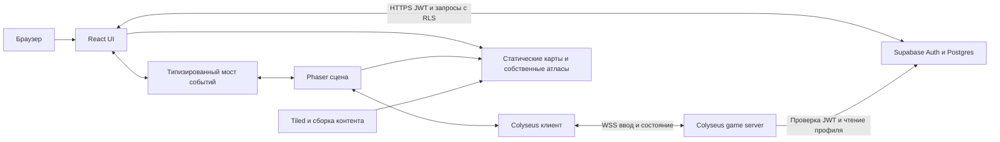

# Creative Factory: независимая архитектура

Дата проектного решения: 23 октября 2026 года. Архитектура остаётся основой разработки. На 26 октября реализованы локальный прототип и код пользовательских экранов/этапа 2; фактический статус и ограничения — в [prototype-status.md](prototype-status.md). Основания исследования — в [workadventure-analysis.md](workadventure-analysis.md), порядок реализации — в [implementation-plan.md](implementation-plan.md).

## Уточнения реализации этапа 2 — 26 октября

Существующие границы модулей сохранены. Auth использует Email OTP (`signInWithOtp` → `verifyOtp`, без постоянного пароля), SDK хранит/обновляет сессию. React-экраны `/`, `/login`, `/profile`, `/avatar`, `/factory` открываются через hash routing, совместимый с GitHub Pages без server rewrite. Локальная прогулка сохранена; Colyseus к браузеру пока не подключён.

В `profiles` display name представлен обязательными `first_name`/`last_name`; UI собирает подпись из них, уникальность имён не требуется. `user_id` — FK на Auth UUID. Остальные поля: `professional_role`, `specialization`, `organization`, `competencies`, `bio`, `portfolio_links`, revision/timestamps. Email хранится только в Auth. `profile_private` пока содержит locale и доступен только владельцу. В `avatar_configs` parts/palette/catalogVersion/presetId находятся в проверяемом JSONB `config`, revision вынесена в отдельную колонку и присоединяется к AvatarConfig в адаптере.

RPC `save_profile`/`save_avatar` работают как SECURITY INVOKER под пользовательским JWT/RLS, берут owner из `auth.uid()` и используют expected revision. Триггеры атомарно увеличивают revision; старый save получает конфликт. Обычным клиентам не выданы UPDATE user_id/revision/timestamps и DELETE. Профессиональная роль не участвует в авторизации. Ограничения полей, HTTPS и IDs проверяются в TypeScript и SQL. Каталог v1 ограничен собственными временными вариантами; его расширение требует согласованной новой миграции.

Предпросмотр и Phaser используют один оригинальный Canvas-рендерер частей. Сохранённый AvatarConfig поступает в FactoryScene при создании game instance. Формы находятся на отдельных экранах, поэтому Phaser и его input listeners уничтожаются при уходе; logout в любой вкладке возвращает на главную. Физика world-core, камера и геометрия карты не изменены. `supabase-setup.md` содержит ручное подключение проекта/SMTP; до него hosted интеграция и доставка не считаются проверенными.

## Уточнение локального демо — 27 октября

По отдельному запросу временно активен `VITE_ACCOUNT_MODE=demo` (default). Существующий AccountProvider получает локальный AccountService из `account/demo.ts` вместо Supabase client. Демоидентичность и versioned localStorage не являются JWT/административной ролью, не обращаются к backend и не используют namespaces реальных аккаунтов. Экраны меню/редактора/завода защищены только локальным флагом сессии; это удобство тестирования, не серверная безопасность. Код настоящего Auth/профилей/RLS сохранён и выбирается явным `supabase`. Демоаватары не переносятся в реальные аккаунты автоматически. Правила реализации и ограничения — [demo-mode.md](demo-mode.md).

## Предыдущий конструктор — 27 октября (история)

Компактный редактор сохраняет прежнюю архитектуру и каталог v1. В AvatarConfig добавлено необязательное строго проверяемое `customization.version=1` со слотами новых вкладок, полом/возрастом/телосложением, независимыми наборами причёсок и дополнительными цветами. Старые сохранения совместимы. Новая миграция расширяет только SQL-валидацию; RLS/owner/revision не меняются. Большинство новых деталей пока сохраняются как заглушки до поставки спрайтов; общий рендерер показывает существующие силуэты, пропорции тела/детской болванки и цвета. Контракт и ограничения — [avatar-constructor.md](avatar-constructor.md).

## Модульный взрослый риг — 27 октября

Графический провайдер собирает один A24 из общей взрослой анатомии, параметров комплекции, художественных частей и палитр. Голова постоянна. Дети мигрируют во взрослые; типы AvatarConfig и catalog v1 сохраняются с нормализацией возраста. Четыре женские причёски — общий маленький индексированный атлас. Реестр частей задаёт крепления, материалы, подгонку, проходы и ручные исключения; конечности и одежда используют одну геометрию. Сборка не выполняется каждый игровой кадр, кэш A24 ограничен 8. Phaser и world-core не переписываются. Полный контракт/ограничения: [TECH_DOCS/ПЕРСОНАЖ](../TECH_DOCS/ПЕРСОНАЖ/README.md).

## Продуктовые границы

Уточнение графического шага 27 октября: представление переведено с вертикального обзора на **3/4 top-down болванки**, без изменения ортогональной геометрии. World state (x,y) — та же точка на полу, визуальный anchor персонажа — ноги (24,56) в кадре 48×64. Стены/предметы и игрок используют общий `feetDepth(Y)`; размеры/высота картинки независимы от collider rectangle. Каталог `content/art/scene-art.json` задаёт кадры, опоры, высоты и процедурный/PNG источник. Композитор частей аватара поддерживает окрашиваемые PNG-маски; кадры и provider общие для React preview и Phaser. Это визуальная замена каталога с прежними IDs, а не новая архитектура или DB-миграция. Полная поставка ассетов описана в [sprite-sheets-spec.md](sprite-sheets-spec.md).

Creative Factory — браузерный 2D-завод с видом сверху для экспертов и педагогов креативных индустрий. Зарегистрированный пользователь создаёт профессиональный профиль, выбирает и редактирует своего аватара, входит в общий мир, перемещается и открывает профили других посетителей. Видимый аватар существует только во время активного подключения к заводу; постоянный профиль сохраняется после выхода.

MVP: один завод, одна карта, один активный аватар на учётную запись; клавиатура и указатель на desktop. Редактирование аватара означает выбор внешности из нашего каталога с сохранением настроек, а не редактор пикселей. Сенсорное управление — последующее расширение с тем же протоколом ввода. NPC, фоновые агенты, экономика, автономная жизнь, видеосвязь и встроенное редактирование карт не нужны.

Изначальный проверочный масштаб: 50 одновременных пользователей, нагрузочный сценарий — 100. Это гипотеза для измерений, не подтверждённая вместимость. При заполнении завод показывает понятный отказ/ожидание, а не создаёт скрытый второй экземпляр мира.

## Стек и ответственность

| Компонент | Ответственность | Что не поручать компоненту |
| --- | --- | --- |
| React + TypeScript | Регистрация/вход, профиль, выбор аватара, панели цехов, состояние подключения, доступные с клавиатуры формы | Покадровое хранение координат всех игроков в React state |
| Phaser | Canvas/WebGL, камера, tilemap, спрайты и анимации, ввод, выбор аватара под указателем | Авторизацию, доверенную проверку скорости и запись профилей |
| Colyseus на Node.js + TypeScript | Единственная авторитетная симуляция, комнаты, временные игроки, patches состояния, lifecycle, фильтрация интереса | Постоянное хранение профилей и передачу каждого шага через SQL |
| Supabase Auth + Postgres + Storage | Учётные записи, профессиональные профили, сохранённая внешность, разрешения, собственные материалы | Второй канал движения/присутствия параллельно Colyseus |
| Tiled | Внешний инструмент создания собственных карт и служебных объектов | Зависимость браузера от редактора или использование карт WA |

Сохраняем запрошенный стек. Упрощаем deployment: статический web, один Node.js game-сервис, managed Supabase. Не нужны отдельный Pusher, gRPC, map-storage, Redis или Kubernetes на старте. Отказ от Colyseus в пользу Supabase Realtime не заменил бы авторитетную симуляцию, а самописный WebSocket lifecycle увеличил бы объём работы.

Версии пока не установлены. В первом прототипе выбрать поддерживаемую версию Phaser, проверить tilemap/анимации и её browser targets; закрепить совместимые версии Colyseus server, schema и client SDK одним lockfile. Не предполагать одинаковые API у разных major-версий. Использование Phaser 4.2.0 в референсе не обязывает нас повторять его выбор.

## Контур системы

Прямые запросы браузера к Supabase работают с publishable key и JWT пользователя под RLS. Ключ не предоставляет административного доступа. Секреты сервера не включаются в web bundle. Game server проверяет подпись/issuer/audience/expiry Supabase JWT через поддерживаемый механизм Auth/JWKS и сам устанавливает userId; userId из клиентского сообщения не является идентичностью.

Для чтения профиля на входе достаточно пользовательского JWT и RLS. Серверные административные credentials, если понадобятся для модерации, хранятся отдельно и не используются как обычный путь чтения профилей. При истечении access token клиент обновляет его через Auth и повторяет авторизацию; бесконечно продлевать игровую сессию по старому JWT нельзя. Для немедленного logout игровая сессия закрывается явно; JWT сам по себе не доказывает мгновенную отзывчивость всех уже открытых соединений.

## Предлагаемые границы модулей

Это будущая структура, перечисленные каталоги пока не созданы:

| Путь | Содержание |
| --- | --- |
| `apps/web` | React shell, auth/profile/avatar UI, Phaser scenes, lifecycle, интерполяция и prediction |
| `apps/game-server` | FactoryRoom, вход/выход, серверный цикл, область интереса, проверка действий и JWT |
| `packages/contracts` | Наши версии сообщений, типы публичного профиля/аватара, runtime-валидация |
| `packages/world-core` | Чистые TS-функции шага движения, AABB/grid-коллизий и геометрии зон; без DOM/Phaser/Supabase |
| `packages/content-tools` | Проверка Tiled export, сборка collision grid и manifest с hash |
| `content/maps`, `content/avatars` | Собственные исходные карты и лицензированные изображения с provenance |
| `supabase/migrations` | Таблицы, RLS, индексы, функции сохранения и увеличения revision |
| `tests/e2e`, `tests/load` | Проверки нескольких настоящих пользователей и нагрузочный стенд |

React монтирует один экземпляр Phaser и уничтожает его при выходе. Типизированный мост передаёт редкие события: выбранный пользователь, открытая зона, готовность сцены, состояние подключения. Подписки и input listeners освобождаются при unmount/смене карты; React StrictMode не должен создавать второй game instance. Формы блокируют игровой ввод, чтобы набор текста не перемещал персонажа.

## Модели данных и права

| Данные | Хранилище и поля | Доступ / жизненный цикл |
| --- | --- | --- |
| Учётная запись | Supabase Auth, `auth.users` | Email и auth-метаданные не входят в игровые сообщения или чужие профили |
| Профессиональный профиль | `profiles`: `user_id`, display name, специализации, роль эксперта/педагога, bio, портфолио, revision, timestamps | Чтение аутентифицированным пользователям; изменение только владельцем. Роли эксперта/педагога — описание профессии, не административные привилегии |
| Непубличные настройки | `profile_private`, отдельно от `profiles` | Только владелец; отсутствие поля в UI не считается защитой |
| Внешность | `avatar_configs`: `user_id`, preset/part IDs, palette, catalog version, revision | Чтение зарегистрированным; изменение владельцем, серверная проверка разрешённых частей и диапазонов |
| Каталог ассетов | Версионированный manifest приложения, Storage/CDN для файлов | Пользователь выбирает ID из каталога, не задаёт произвольный URL/скрипт |
| Мир и игроки | Память FactoryRoom: `players`, server tick, content version | Удаляется при выходе/обнаруженном обрыве; не является таблицей «онлайн» в Postgres |
| Краткая резервация восстановления | Приватная память сервера: user/session, last safe position, expiry | До 20 секунд после разрыва как исходный параметр. Не входит в синхронизируемое состояние и не отображается |

На `profiles`/`avatar_configs` включить RLS: anon запрещён; `SELECT` для authenticated; `INSERT/UPDATE` с `auth.uid() = user_id` и соответствующим `WITH CHECK`. Пользователь не может назначить себе чужой user_id или роль администратора. Политики Storage ограничивают запись владельцем и типы/размеры загружаемых файлов. В MVP аватар собирается из нашего каталога без пользовательских загрузок.

Если позже появится приватность отдельных профессиональных полей, разделить записи/политики по уровню доступа. RLS фильтрует строки и сама по себе не скрывает выбранную колонку в разрешённой строке. Не создавать публичный view, случайно обходящий политики; проверять доступ с реальными JWT и anon.

Сохранение профиля/аватара атомарно увеличивает revision; конкурентное изменение с устаревшей revision получает конфликт. После сохранения клиент уведомляет game server о новой revision; сервер перечитывает запись, проверяет её и меняет только небольшие публичные данные. Переданный клиентом набор чужих частей не принимается как подтверждённое сохранение. Остальные видят новую внешность без нового входа; ошибочная загрузка заменяется нашим fallback, а не внешним ресурсом.

Профиль открывается из React по клику на видимого игрока либо по доступному списку игроков поблизости. Из состояния мира достаточно получить стабильный profile/user ID и краткую подпись. Полная bio и портфолио загружаются по запросу через RLS. Текст выводится как текст, ссылки допускаются только с разрешённой схемой HTTPS; HTML пользователя не исполняется.

## Единый завод и lifecycle

MVP обслуживает один процесс Colyseus и одну каноническую `FactoryRoom` для `worldId = creative-factory`. HTTP admission endpoint того же сервиса возвращает reservation/roomId после проверки доступа. Создание комнаты сериализуется сервером: две одновременные попытки не создают два мира. Клиент подключается к конкретной комнате, а не вызывает неограниченный `joinOrCreate` с возможностью появления дополнительной комнаты при заполнении.

Один реестр активных сессий по userId не допускает двух аватаров из разных вкладок. Успешный новый вход вытесняет предыдущий; UI старой вкладки объясняет причину и прекращает автоматические повторы. Каждое подключение имеет server-issued session epoch; input и завершение старой сессии не могут удалить или переместить новую. Первичная идентичность — userId, sessionId — текущий транспорт/lifecycle.

Последовательность входа:

1. Auth выдаёт действующий JWT; пользователь заполняет профиль и сохраняет внешность.
2. Admission/room authentication проверяет JWT, доступ, вместимость, профиль и catalog version.
3. Сервер выбирает свободную от стен точку в spawn-зоне и возвращает content manifest, epoch и начальное состояние. Пользователь не выбирает произвольные x/y.
4. Phaser загружает нужную карту и атласы, сверяет hash и сообщает готовность с ограничением времени ожидания. До готовности аватар не добавляется в общий `players`.
5. Сервер публикует игрока; клиент начинает отправлять ввод. Подписки на добавление/удаление обрабатывают и первоначальное состояние, и последующие patches без двойных спрайтов.

| Событие | Поведение |
| --- | --- |
| Кнопка «Выйти из завода» | Прекратить ввод, отправить consented leave, удалить игрока сервером и закрыть комнату. Профиль/аватар в БД сохраняются |
| Logout | Сначала локально прекратить управление и закрыть игровую сессию, затем очистить Auth-сессию. Выход из аккаунта не должен оставлять аватар |
| Закрытие вкладки | WebSocket close — полезный сигнал, но `beforeunload` не гарантируется; fallback — heartbeat |
| Неожиданный разрыв | После обнаружения убрать запись из видимого `players` и области интереса, обнулить движение; сохранить приватную резервацию позиции |
| Reconnect в пределах резервации | Проверить reconnect credential и действующую авторизацию, восстановить одну сессию, прислать свежий снимок; повторно опубликовать игрока после готовности |
| Истечение резервации / restart сервера | Обычный новый admission, безопасный spawn; старую историю input не проигрывать |
| Отказ Auth / вытеснение другой вкладкой | Завершить повторы, показать вход/причину. Не превращать отказ в reconnect loop |

Использовать штатные reconnect-возможности Colyseus, а удаление видимого состояния выполнять при обнаружении drop, не дожидаясь конца grace period. Точные hooks (`onDrop`, `onLeave`, resume) зависят от выбранной версии: первый прототип обязан показать, что резервирование подключения не оставляет аватар в `players`. При отсутствии подходящего hook использовать свежий admission с серверной резервацией позиции, сохраняя ту же продуктовую семантику.

Исходные параметры обнаружения: heartbeat каждые 3 секунды, удаление при 3 пропущенных ответах, целевой верхний предел 10 секунд в исправно работающем сервере. Явный leave — не позднее следующего patch; при фоновой вкладке и мобильном suspend эти параметры проверить отдельно. Мгновенного удаления при необнаружимом сетевом разрыве не обещаем. Reconnect: backoff с jitter, 0.5–5 секунд, максимум 20 секунд до перехода к обычному входу. Токены не логируются; содержимое сообщений ограничивается по размеру и частоте.

## Движение, коллизии и сетевое отображение

Сервер — источник истины для координат, направления, mapId и действий. Клиент посылает bounded input: `seq`, кнопки/направление, session epoch; без доверенных координат, скорости или произвольного delta time. Сообщения проходят runtime-валидацию, ограничение частоты и защиту от NaN/Infinity. Клиент не может увеличить пройденное расстояние количеством сообщений.

Исходный режим для прототипа: simulation tick 30 Hz, input до 30 Hz, state patches 15 Hz, render по частоте браузера. В рамках одного серверного тика допускается не более одного шага фиксированного времени на игрока. Валидные команды упорядочены по seq; очереди ограничены, накопленный input после задержки/фонового режима не догоняется пачкой ускоренных шагов. После 250 мс без свежего ввода — нейтральный input. Конкретное соответствие seq и отработанного шага фиксируется в протоколе; ack обозначает именно обработанную границу input, а не просто последний принятый пакет.

`world-core` реализует одинаковый фиксированный шаг для сервера и prediction. Вектор диагонали нормализуется; скорость едина. Collision grid собирается из нашей карты: полные препятствующие клетки, AABB небольшой области у ног, осевое разрешение столкновений и подшаги при необходимости, чтобы не проходить через тонкую стену. Для MVP исключить наклонные поверхности, произвольные полигоны и движущиеся препятствия. Аватары могут проходить друг сквозь друга — люди не блокируют двери и spawn.

Клиент немедленно предсказывает движение своего персонажа. Серверные данные содержат tick, position, direction, last processed input seq и session epoch. Reconciliation возвращает physics state к подтверждённой точке и применяет ещё не подтверждённые шаги по определённым правилам; небольшое визуальное расхождение сглаживается, большие ошибки/телепорт сбрасывают буфер. Лимиты input/ack и потери сообщений должны проверяться тестами до добавления сглаживания.

Для удалённых игроков клиент собирает буфер позиционных снимков из Colyseus patches, учитывая их server tick. Исходная задержка отображения 100–150 мс; между снимками — линейная интерполяция. При нехватке данных допустима экстраполяция не более 100 мс с последующей остановкой. По возобновлении не продолжать уход за стену. Телепорт, смена mapId/epoch, повторный вход и удаление очищают буфер. Colyseus сериализует состояние, но эту визуальную логику автоматически не создаёт.

WebSocket сохраняет порядок в живом соединении; seq/epoch нужны для reconciliation, дубликатов на уровне приложения и смены сессии. Восстановление не повторяет накопленные движения старой сессии. Клиентский clock offset оценивается относительно server time, не по совпадению часов устройств. Остановка и снятие фокуса отправляют нейтральный input, серверный timeout остаётся обязательным.

## Карты, визуальные слои и контент

MVP поддерживает конечную orthogonal Tiled JSON-карту с tileset metadata внутри export и ссылками на наши изображения. Предварительный размер клетки — 32 px, без требования повторять внешний вид референса. Content pipeline валидирует тип карты, размеры, layer names, объекты, ID, диапазоны и пути; unsupported transforms/encoded layers либо нормализуются сборкой, либо отклоняются с понятной ошибкой. Не интерпретировать непроверенные файлы как код.

| Слой / объект | Наш контракт |
| --- | --- |
| `ground`, `ground-details` | Статические плитки ниже всех персонажей |
| `solids` | Данные блокировки; могут совпадать с видимыми стенами, но collision grid имеет отдельную явную семантику |
| `world-props` | Высокие предметы, создаваемые как объекты с координатой основания; сравниваются по feet-Y с персонажем |
| `overhead` | Потолочные детали поверх персонажей, отдельный фиксированный диапазон depth |
| `spawns` | Прямоугольные объекты с уникальным spawnId, позиции только на проходимых клетках |
| `interactions` | Прямоугольники с уникальным zoneId, enum action, contentId и текстом подсказки |
| `portals` | Объекты targetMapId + spawnId; в MVP могут отсутствовать |

Это наши правила, а не совместимый формат карты WorkAdventure. Для высоких станков изображение можно разделить на основание и верхнюю часть, если простая Y-сортировка недостаточна. Положение персонажа и глубина определяются ногами, имя и selection overlay имеют отдельные слои. Замерять draw calls, число видимых объектов и atlas switches; не генерировать дорогие портреты каждого входящего синхронно в одном кадре.

Сборка выдаёт общий content manifest с версией/hash, render data и collision grid из одного экспорта. Клиент и сервер обязаны использовать одну версию; несовпадение блокирует вход и предлагает перезагрузку. Файлы публикуются с immutable URL по hash. Изменение карты не меняет коллизии уже работающей комнаты посередине тика; MVP обновляет комнату контролируемым restart/rejoin. Отсутствующий tileset или ошибка загрузки не публикует невидимого игрока.

Аватары создаются из собственных/приобретённых совместимых атласов. Каталог описывает порядок частей и семантические направления/idle/walk; номера кадров определяются нашим manifest. Все части используют общую фазу анимации. Сетевое состояние несёт конфигурацию/revision, движение — только необходимые числовые поля. Shared texture cache не уничтожается при уходе одного пользователя; принадлежащие ему sprites/listeners уничтожаются обязательно. Лицензионный реестр ассетов создаётся до включения графики в продукт.

## Область интереса

В первом вертикальном прототипе до 50 участников допустим полный state broadcast одной комнаты, чтобы сначала проверить корректность. Это временная стадия, не реализация сетевой оптимизации. Phaser camera culling уменьшает рендеринг, но не объём передаваемых состояний.

Следующая стадия: серверная spatial grid по mapId и координатам, вычисление ограниченного прямоугольника/радиуса интереса вокруг подтверждённой позиции. Viewport клиента лишь подсказка: ограничить размер, zoom и удалённость от игрока. Соседние клетки включаются с запасом и hysteresis, чтобы персонажи не мерцали на границе.

Для каждой сессии Colyseus StateView/поддерживаемая фильтрация выбранной версии передаёт только свой и видимые PlayerState, включая initial snapshot и metadata частей. Фильтровать только x/y, оставляя общий MapSchema всех игроков, недостаточно. API views проверить прототипом, а не предполагать доступность по названию библиотеки. Добавление в область интереса создаёт спрайт из полного состояния; удаление очищает его и буферы, но не объявляет пользователя вышедшим из завода.

При примерно равномерном распределении ожидается стоимость рассылки порядка `N × K`, где K — число получателей поблизости, вместо `N²`. Если все находятся в одном цехе, K может стать N: пространственная фильтрация не спасает плотную толпу. Число участников ограничивается измеренными CPU/bandwidth/frame-time, а не обещанием бесконечного масштабирования.

## Зоны и переходы

Вход/выход из прямоугольной зоны вычисляется по множеству активных zoneId; событие отправляется при смене множества, не каждый render frame. Чисто информационная подсказка может быть локальной. Действие, меняющее общий мир или доступ, сервер повторно проверяет по подтверждённой позиции и разрешённому action/contentId. Перекрывающиеся зоны имеют стабильный приоритет и явный выбор; действие не срабатывает многократно из-за дрожания на границе. Никаких удалённых JS-скриптов из Tiled и `eval`.

Переходы между картами откладываются за MVP, но протокол оставляет mapId. Самый простой следующий шаг — несколько карт внутри той же FactoryRoom. Сервер выдаёт transitionId и version целевой карты, замораживает input; клиент предварительно загружает контент и отвечает ready. Сервер проверяет deadline и portal, атомарно меняет mapId/позицию, инвалидирует старые буферы и обновляет видимость. Одинаковые mapId обозначают ту же область единого завода, а не параллельные инстансы.

Если целевой контент не загрузился, сервер отменяет переход и оставляет игрока на безопасной точке исходной карты. Повторное ready с тем же transitionId ничего не меняет. Переход на ту же карту — авторитетный teleport с явным признаком сброса интерполяции. Разделение карт на разные процессы потребует отдельного одноразового handoff и глобальной блокировки двойного присутствия; это отдельная будущая задача, не скрытая возможность MVP.

## Развёртывание и наблюдаемость

Первый deployment: один статический web-host, один Colyseus process за reverse proxy с WSS/TLS и настроенным idle timeout, managed Supabase. В dev достаточно web и game server плюс отдельный dev-проект Supabase; локальный полный Supabase через CLI/Docker — опционально. На этапе аудита credentials не запрашиваются и ресурсы не создаются.

Будущие параметры: публичные URL Supabase и publishable key для web, game endpoint, разрешённый web origin, server-side Auth/JWKS configuration и content version. Конкретный набор переменных закрепляется при реализации; реальные секреты — через среду deployment, без записи в документацию/репозиторий. Разделить dev/prod Supabase и callback URLs.

Метрики: active/pending/reserved players, reconnect success, duplicate-session rejection, tick duration, missed ticks, bytes/sec и размер очередей по клиенту, число видимых игроков, рассогласования позиции и ошибки контента. Логи используют session/correlation ID без JWT, email и bio. Медленный клиент получает ограниченный backlog и принудительную resync/переподключение вместо неограниченного роста памяти.

Стартовые цели для проверки: simulation tick p95 < 20 мс при 50 участниках; 60 FPS на зафиксированном desktop-профиле при 30 видимых аватарах; сетевое поведение при RTT 150 мс и jitter 50 мс; удаление по heartbeat ≤ 10 секунд. Это будущие acceptance targets. Итоговый отчёт обязан указывать устройство, карту, число слоёв/частей аватара и реальные значения; сейчас измерений нет.

Горизонтальное масштабирование запрещено «включать репликами» без маршрутизации одной комнаты к одному владельцу и общего реестра сессий. Сначала измерить один процесс; затем проектировать partition по картам, distributed presence/fencing и handoff. NPC или фоновая жизнь для поддержания пустой комнаты не нужны: без игроков нет сущностей, которым требуется симуляция.

## Открытые решения и обязательные проверки

До основной реализации нужны: фиксация версий и browser targets; spike совместимости Phaser/Colyseus; подтверждение server hooks удаления при drop; проверка схемы ack/reconciliation; прототип filtered state; собственный визуальный каталог с подтверждёнными правами. Неизвестный фактический масштаб не мешает начать с указанных лимитов, но увеличение вместимости возможно только после нагрузочных измерений.

Лицензии компонентов и их границы приведены в [аудите](workadventure-analysis.md#лицензии-и-независимая-реализация). WorkAdventure не входит ни в runtime, ни в build dependencies. Наш код не основан на копировании его классов, протоколов, WAM-файлов, стиля или ассетов.
